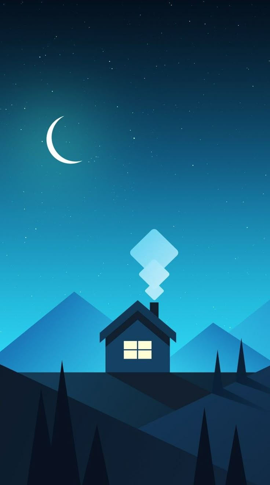
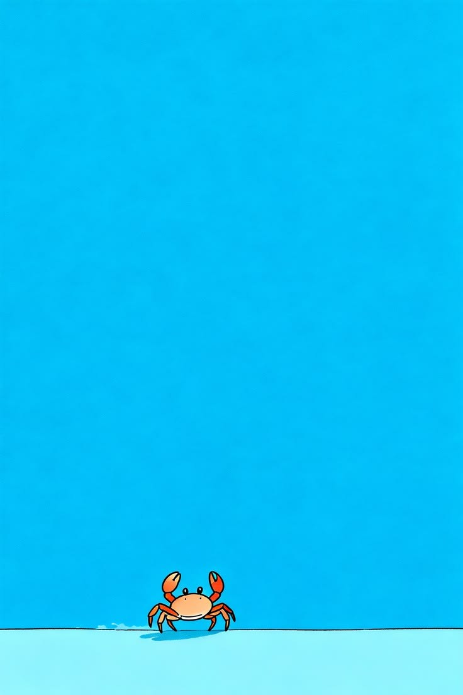
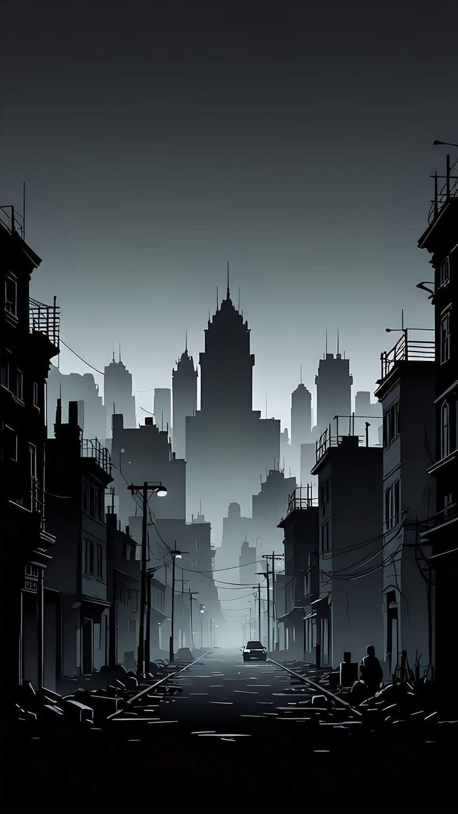

# Chain Reaction Music · Skins

Colección de fondos seleccionados para el reproductor Android, independiente del código y de los instaladores.

## Galería inicial

Siete imágenes ya utilizadas en la app: Noche serena, Isla turquesa, Astronauta, Bosque de invierno, Cangrejito, Ciudad en sombras y Caracoles.

| Skin | Vista |
| --- | --- |
| Noche serena |  |
| Isla turquesa |  |
| Astronauta |  |
| Bosque de invierno |  |
| Cangrejito |  |
| Ciudad en sombras |  |
| Caracoles |  |

## Archivos

- `images/`: copias seleccionadas, sin modificar los originales.
- `catalog.json`: nombres, rutas relativas, dimensiones, tamaño y SHA256 para validar cada descarga.
- `SHA256SUMS.txt`: comprobación independiente de las imágenes.

El campo `palette: from-image` indica que la app puede tomar los colores de la imagen; el catálogo no define un tema fijo.

## Agregar un fondo

Usar una imagen vertical JPG, darle un nombre simple y añadir su entrada en catalog.json con tamaño, dimensiones y SHA256. Mantener identificadores existentes para que no se pierdan las selecciones guardadas.

Las imágenes conservan los derechos de sus autores; no se asigna una licencia general a la colección. La carpeta original completa y los documentos personales no forman parte de este repositorio.

## Estado de la app

Las siete skins iniciales ya están incluidas en la app. La versión actual permite elegir una imagen del teléfono. La galería remota que consulta este catálogo requiere una actualización adicional; crear este repositorio no cambia por sí solo las versiones instaladas.
